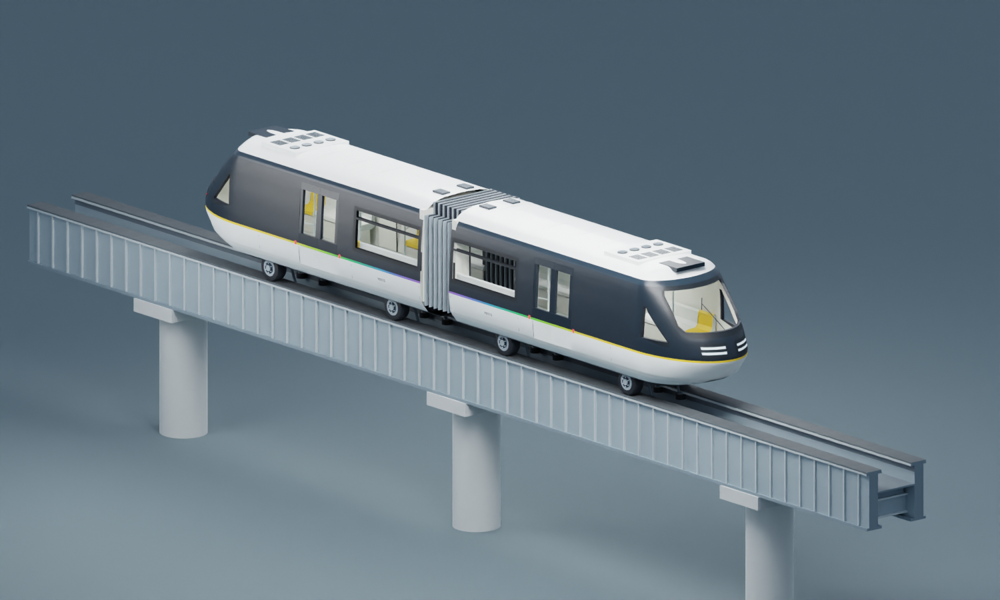
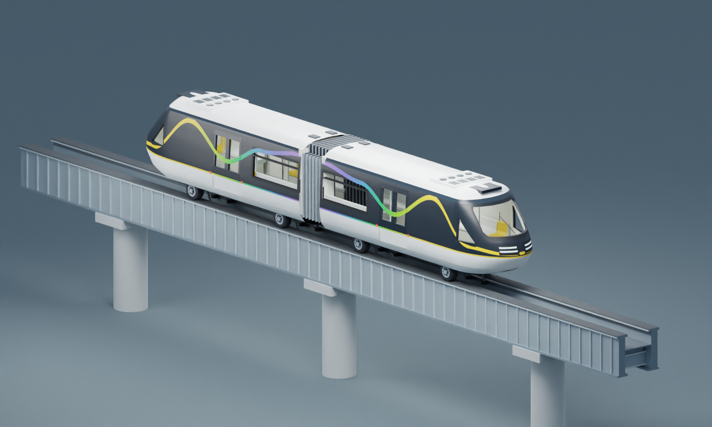
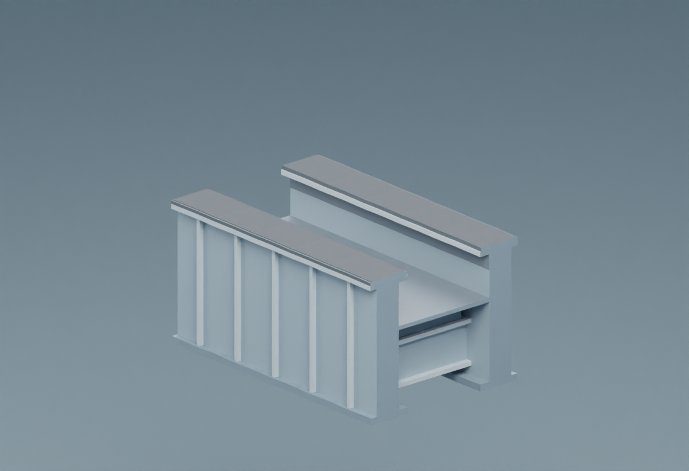
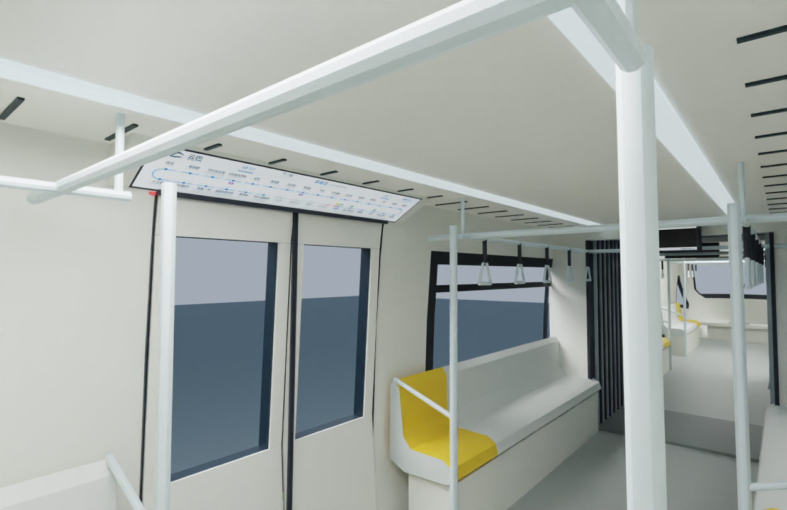
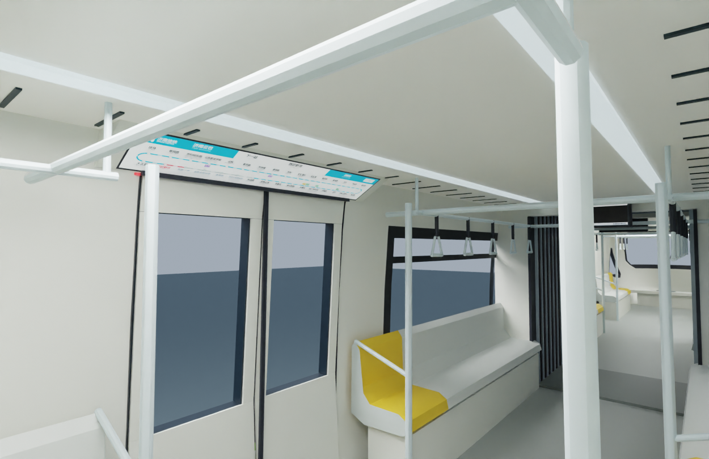

# 济南云巴 1 号线

适配 Minecraft 1.20.4 Fabric、Minecraft Transit Railway 4.0.5 和 Joban Client Mod 2.3.0。门楣 LCD 和吊装电视由 JCM 绘制。本追加包使用GPT-6.2-sol (high) 接入Codex制作。

相关链接：
- 济南地铁A型车：https://github.com/EnderBrighter/mtr-jinan-A-46789
- 蓝奏云网盘：wwamy.lanzoub.com/b0018sosta   （密码：mtr）
- 百度云盘：https://pan.baidu.com/s/1ywGuDcF5GXat6KA9A41DPA?pwd=2026

## 游戏内使用

1. 在 MTR 列车侧线中按顺序添加同一涂装、同一 LCD 版本的前后两节车厢。细彩带和彩波纹各有旧版 LCD 和新版 LCD，共四套。
2. 在轨道样式里选择「济南云巴 | 钢制胶轮导轨梁」，移除同段默认钢轨样式，避免两套模型重叠。

---

`以下内容为AI撰写`

---

## 车辆与屏幕

- 在 MTR 车辆选择界面选中具体列车后，详情栏会显示最高时速 80 km/h、建议加速度 1.0 m/s²、最小转弯半径 50 m 和极限转弯半径 15 m。50 m 指一般线路的设计取值。1.0 m/s² 是模组使用建议。[中国中铁开通资料](https://www.crec.cn/web/xwzx61/gsyw87/2025121010111164746/index.html) · [云巴规划设计研究](https://csdqyfh.ijournals.cn/csdqyfh/article/pdf/241120)
- 两节头车中心距 8.80 米，编组全长约 17.60 米。每节车体长约 8.30 米、宽 2.40 米，轴距 4.20 米，门洞为 1.30 × 1.85 米。直线贯通间距约 0.98 米。
- 旧版门楣 LCD 在运行中轮换全线图和三站预览。两个版本都读取 MTR 的顺时针、逆时针环线设置。普通线路按站数使用一排或两排并显示终点站。实际开门时显示停靠站和开门侧，对侧开门页带红色禁止标志。
- 新版门楣 LCD 参照实拍，使用青色两端栏、左侧「济南地铁」标志及中英字标、「济南云巴」字标、浅底中栏和「车-门号」编号。运行时显示全线图，开门页居中显示站名和出站换乘，两侧显示车门图示。小电视的左上角改用「济南地铁」标志和字标。
- 近贯通道的吊装电视按实拍比例放大，外壳约 0.51 × 0.25 米。左侧显示下一站或停靠站，第二栏在环线显示运行方向，在普通线路显示终点站。环线方向读取 MTR 线路的 `getCircularState()`。右侧视频区使用黑色占位，底部欢迎语持续从右向左滚动。
- 车顶按照片布置每节一组主空调风口及贯通端小设备。侧面保留有实拍依据的细彩带和大彩波纹。
- 前风挡、三角窗、固定侧窗和门窗使用清透开口，便于 Minecraft 正常绘制窗外水体。彩波纹印花沿窗面延续，门上的印花随门叶移动。门叶顶部和中缝设胶条。贯通道渡板与车厢地板保持约 27 毫米的高差，端裙板向车内退 16 毫米以避开重合的端面。

## 模型、预览与验证

- `source/jinan_y1.blend` 是 Blender 3.0 工程，贴图已内嵌。导轨梁采用双走行面和相向内侧导向面，按 0.50 米重复铺设。每个模块实际长 0.65 米，两端逐渐内收，让相邻模块搭接。桥墩为 Blender 场景中的支撑。
- `preview/` 包含涂装、客舱、导轨和贯通道底部渲染，另有半径 15 米的弯道预览。LCD 和电视样图由包内脚本绘制，预览站名使用测试线路数据。
- 用 MTR 4.0.5 的导轨采样位置离线核对了半径 15 米左弯、右弯、坡道弯，以及直线和 S 弯的接缝。用 JCM 2.3.0 内置 Rhino 分别实现了顺时针、逆时针和普通线路在两块屏上的标签。

## 图集

## 参考资料

- 济南云巴运营实车、钢梁实拍及线路开通资料。[中国中铁](https://www.crec.cn/web/xwzx61/gsyw87/2025121010111164746/index.html)
- 首车的车顶设备、车头和细彩带涂装。编组长度 17.6 米、车宽 2.4 米。[新黄河首车照片](https://news.e23.cn/jnnews/2025-03-10/2025031000198.html) · [国际在线开通报道](https://big5.cri.cn/gate/big5/sd.cri.cn/20251206/e50c5b9c-19ef-41e1-b791-5753fdc9c176.html)
- 客舱布局、门上横屏和近贯通道吊装电视。LCD 页面布局、彩波纹外观也参照用户提供的原车实拍画面。[闪电新闻客舱照片](https://jinan.iqilu.com/news/2025/0807/5839541.shtml) · [新黄河现场探访](https://news.e23.cn/jnnews/2025-12-06/2025C0600114.html)
- 「济南地铁」篆体「泉」图形核对集团发布图册封面的标志，并按车内屏的反白图形重绘为矢量路径。[济南地铁图册](https://jnjtj.jinan.gov.cn/attach/0/8053738ea6514bf3ba1d90ca66cd5ac9.pdf)
- 车体长、轴距、轮距、车门和导轨梁宽度采用同制式头车的公开规范作参照。轨道断面细部、窗框和设备尺寸结合济南实拍及专利图估算。[深圳 DB4403/T 6—2019 第 5.1.3 节](https://amr.sz.gov.cn/attachment/1/1681/1681897/2296047.pdf) · [济南工程设计论文](https://csdqyfh.ijournals.cn/csdqyfh/article/html/241120) · [比亚迪导轨梁专利](https://patents.google.com/patent/CN112575669A/zh)
- 济南云巴实际站序与内外环。[高德线路图](https://www.amap.com/ssr/subway/jinan-3701) · [闪电新闻通车前探访](https://jinan.iqilu.com/news/2025/1126/5870645.shtml)
- 动态屏使用 JCM 车辆脚本和动态材质接口。[JCM 车辆接口](https://jcm.joban.org/v2.3/dev/scripting/type/vehicle/) · [JCM 动态材质](https://jcm.joban.org/v2.3/dev/scripting/dynamic_textures/)
